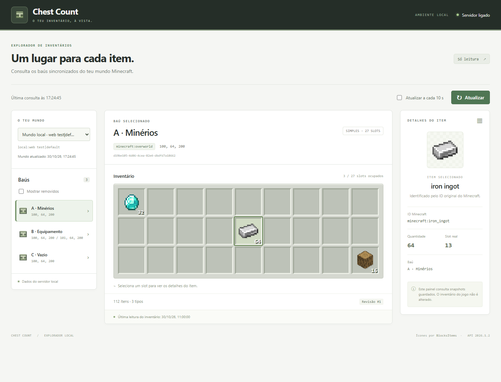

# Chest Count — servidor e explorador de inventários

Servidor Python local com SQLite, sincronização incremental do mod Chest Count e uma interface web de leitura em **http://127.0.0.1:8080/**.

HTML, CSS e JavaScript vanilla. O servidor utiliza apenas a biblioteca padrão do Python: sem React, Vite, Node, npm ou processo de build.



*A captura usa exclusivamente fixtures de testes. A interface em execução consulta os dados reais recebidos do mod; não preenche a base de dados com demonstrações.*

## Iniciar

Com Python 3.10 ou superior, na pasta do projeto:

```powershell
python server.py
```

Abre **http://127.0.0.1:8080/**. Para parar, usa Ctrl+C apenas no terminal deste servidor. Se a porta estiver ocupada, identifica a instância Chest Count antes de a encerrar; não termines processos Python por nome.

```powershell
python server.py --host 127.0.0.1 --port 8081
python inspect_db.py
```

O servidor cria `data/chestcount.db` se ainda não existir. Não migra nem apaga os JSONs legados. `data/`, logs, manifests de processos e evidências locais com dados reais estão excluídos do Git.

## Interface

- Seleção de mundo e baú, coordenadas, dimensão e revisão do servidor.
- Inventário real com 27/54 slots, posições originais, slots vazios e quantidades por stack.
- Seleção por clique/teclado e painel com ID, quantidade, slot e nome do baú.
- Ícones diretos da [BlocksItems API](https://blocksitems.com/api), versão `2026.1.2`, com fallback SVG local.
- Atualização manual ou automática a cada 10 segundos; pausa enquanto a aba está oculta e conserva a seleção.
- Estados vazios, servidor indisponível, inventários não confirmados, estrutura alterada e tombstones.

A interface é exclusivamente de leitura. Não altera inventários físicos, não envia alterações à sincronização e não implementa Player Status. A API de sincronização já existente continua a receber os pedidos do mod.

## API e persistência

| Método | Endpoint |
| --- | --- |
| POST | `/api/v1/sync` |
| GET | `/api/v1/health` |
| GET | `/api/v1/worlds` |
| GET | `/api/v1/worlds/{worldId}/chests` |
| GET | `/api/v1/worlds/{worldId}/chests/{chestId}` |
| GET | `/api/v1/worlds/{worldId}/export` |
| GET | `/api/v1/worlds/{worldId}/changes?since=0&limit=100` |
| POST | `/api/sync` — arquivo legado, separado do SQLite |

O SQLite consolida mundos, baús e itens, com revisões por baú, tombstones, recibos idempotentes e cursor global de eventos. Exemplos de contrato: [pedido](docs/examples/sync-request.json) e [resposta](docs/examples/sync-response.json). São exemplos sintéticos de documentação; não são enviados automaticamente.

## Testar

```powershell
python -m unittest -v test_server test_web
python -m unittest -v test_web_browser
```

Os testes criam bases temporárias e servidores em portas dinâmicas. Não utilizam a base real. Os testes de navegador são opcionais: usam Chrome/Edge já instalado e `websocket-client`, se ambos estiverem disponíveis; caso contrário ficam explicitamente ignorados. Nenhuma dessas ferramentas é necessária para iniciar ou utilizar o servidor.

Nesta implementação passaram **41 testes**, incluindo **11 no navegador**, sem falhas ou testes ignorados. Os quatro ícones pedidos (`diamond`, `iron_ingot`, `oak_log`, `netherite_sword`) responderam 200 com PNG válido; um ID inexistente respondeu 404 e acionou o placeholder local no navegador.

## Documentação

- [Interface, segurança e limitações](docs/WEB-UI.md)
- [Relatório de implementação e testes](docs/WEB-VALIDATION.md)
- [Servidor, SQLite, revisões e idempotência](README-Server.md)
- [Contrato OpenAPI](openapi.json)
- [Captura em telemóvel com fixtures](docs/screenshots/mobile.png)

Este é um servidor de desenvolvimento em loopback. Não inclui autenticação ou TLS para exposição pública e não é o website Yii2 definitivo. A interface recusa acesso se o servidor estiver ligado a uma interface não loopback, mesmo que a API tenha sido configurada para outro host.
